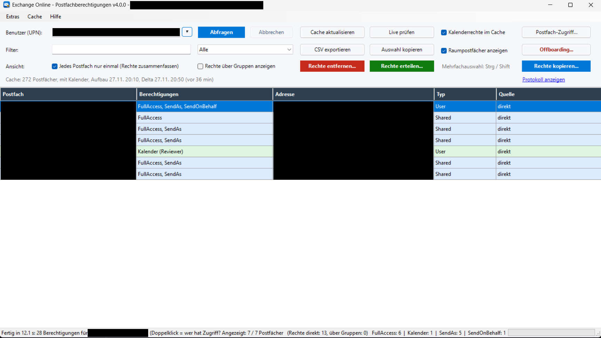
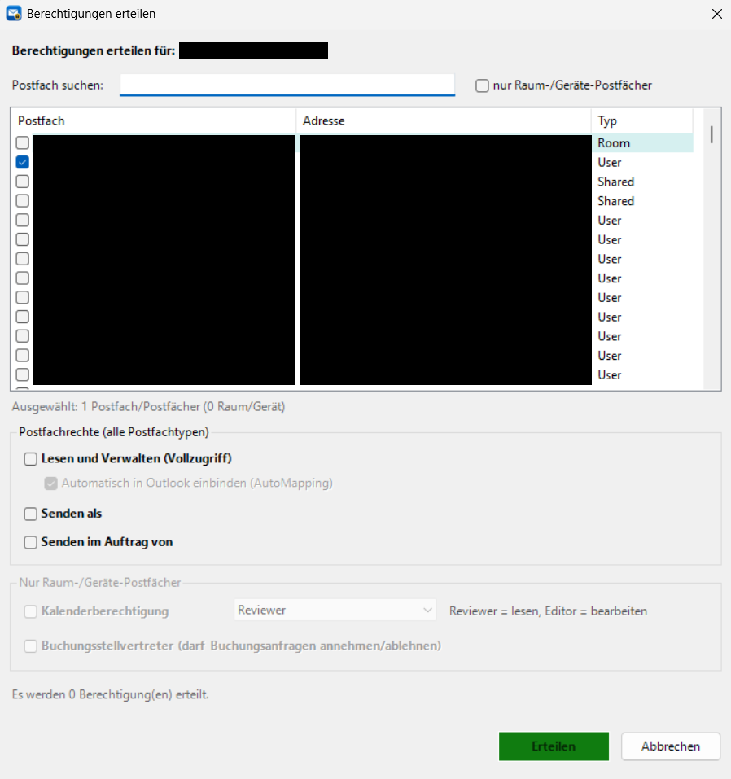
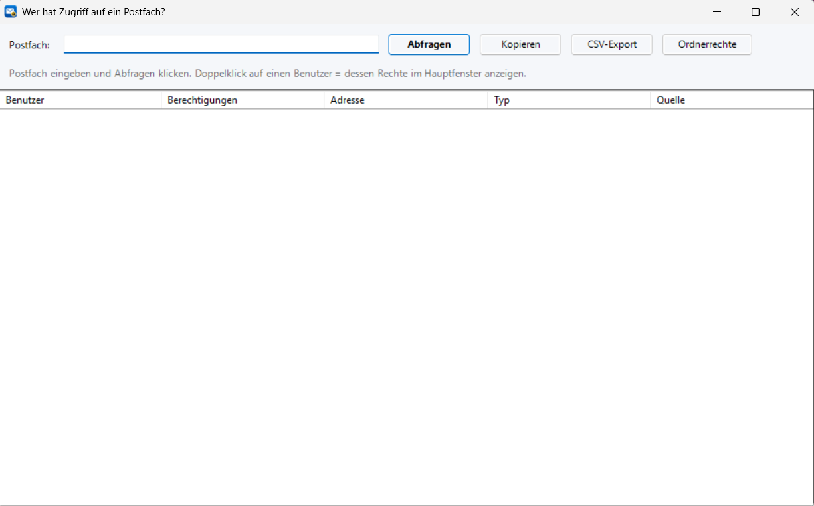
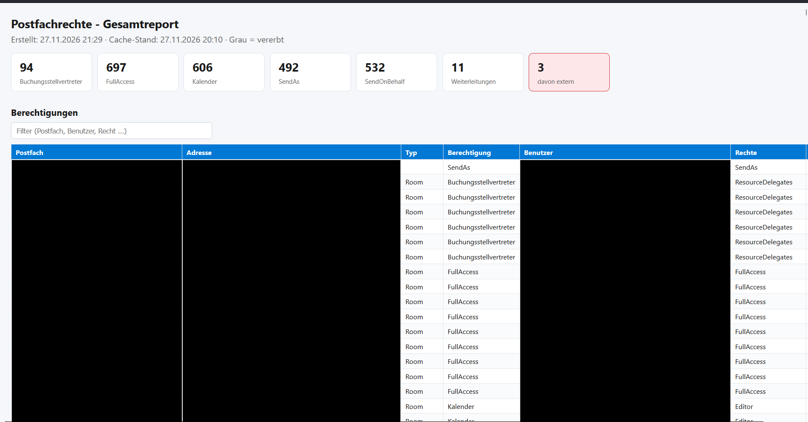

# MailboxAccess – Exchange Online Postfachberechtigungen

[](https://github.com/RazeAttack/MailboxExchangeGUI/actions/workflows/ci.yml)
[](https://github.com/RazeAttack/MailboxExchangeGUI/releases/latest)

> **English summary** – see [below](#english-summary).

PowerShell-Tool mit GUI, das anzeigt, **auf welche Postfächer ein Benutzer in Exchange Online berechtigt ist** – inklusive Berechtigungen über Gruppen.

| Berechtigung   | Quelle          | Hinweis                                       |
|----------------|-----------------|-----------------------------------------------|
| FullAccess     | Cache           | inkl. vererbter Rechte                        |
| SendAs         | live            | 1 Aufruf je Benutzer/Gruppe                   |
| SendOnBehalf   | live            | 1 Aufruf je Benutzer/Gruppe                   |
| Kalender       | Cache (optional)| Ordnerrechte auf `Kalender` / `Calendar`      |
| Buchungsstellvertreter | Cache   | Raum-/Gerätepostfächer (`ResourceDelegates`)  |

---

## Screenshots

| Hauptfenster | Rechte erteilen |
|---|---|
|  |  |

| Postfach-Zugriff | Tenant-Report |
|---|---|
|  |  |

---

## Download

Fertige EXE: **[Releases](https://github.com/RazeAttack/MailboxExchangeGUI/releases/latest)** → `MailboxAccess.exe`
(Prüfsummen in `SHA256SUMS.txt`). Das Tool zeigt in der Statusleiste an, wenn eine neuere Version verfügbar ist.

### Code signing policy

Free code signing provided by [SignPath.io](https://about.signpath.io), certificate by [SignPath Foundation](https://signpath.org).

Rollen, Ablauf, Datenschutz und Deinstallation: **[Code signing policy](CODE_SIGNING_POLICY.md)**

---

## Inhalt

```
MailboxAccess/
├── Get-UserMailboxAccess.ps1    # Hauptskript (GUI + Konsole) – wird aus src\ zusammengesetzt
├── Build-MailboxAccessExe.ps1   # Baut MailboxAccess.exe (Starter mit eingebettetem Skript)
├── src/                         # Quellcode, aufgeteilt nach Bereichen
│   ├── 00-Header.ps1            #   Hilfe, Parameter, Diagnose, Modulprüfung
│   ├── 10-Allgemein.ps1         #   Verbindung, Hilfsfunktionen
│   ├── 20-Cache.ps1             #   Cache aufbauen / laden / live prüfen
│   ├── 21-DeltaUpdate.ps1       #   Delta-Update über das Audit-Log
│   ├── 22-UpdateCheck.ps1       #   Update-Prüfung (GitHub-Release)
│   ├── 30-Abfrage.ps1           #   Rechte eines Benutzers
│   ├── 40-Extras.ps1            #   Weiterleitungen, Ordnerrechte, Gruppen, Tenant-Report
│   ├── 50-PostfachSicht.ps1     #   Wer hat Zugriff auf ein Postfach?
│   ├── 60-Erteilen.ps1          #   Rechte erteilen
│   ├── 70-Entfernen.ps1         #   Rechte entfernen
│   ├── 80-Konsole.ps1           #   Konsolenausgabe
│   ├── 90-Start.ps1             #   Start / Konsolenmodus
│   ├── 91-GuiZustand.ps1        #   gemeinsamer Zustand GUI <-> Arbeits-Thread
│   ├── 92-GuiOberflaeche.ps1    #   WinForms-Oberfläche (eigener Thread)
│   └── 99-GuiSchleife.ps1       #   Arbeitsschleife (Exchange-Aufrufe)
├── build/
│   ├── Merge-Source.ps1         # src\*.ps1 -> Get-UserMailboxAccess.ps1
│   ├── New-Release.ps1          # Version hochsetzen, CHANGELOG, Commit, Tag
│   └── Test-Project.ps1         # Prüfungen (Syntax, BOM, Analyzer, Version)
├── .github/workflows/
│   ├── ci.yml                   # Prüfung bei jedem Push
│   └── release.yml              # Tag v*.*.* -> EXE bauen + GitHub-Release
├── docs/screenshots/            # Bilder für die README
├── mailbox.ico                  # Icon für die EXE (16–256 px)
├── .signpath/artifact-configuration.xml  # Vorlage für die SignPath-Artefaktkonfiguration
├── CODE_SIGNING_POLICY.md       # Code signing policy (SignPath Foundation)
├── LICENSE                      # MIT
├── CHANGELOG.md
├── README.md
└── .gitignore
```

---

## Voraussetzungen

- Windows 10/11 mit **Windows PowerShell 5.1**
- Modul **ExchangeOnlineManagement** v3.x (für Windows PowerShell 5.1 installiert)
  ```powershell
  powershell.exe -Command "Install-Module ExchangeOnlineManagement -Scope CurrentUser"
  ```
- Rolle in Exchange Online: **Exchange-Administrator** oder mindestens **View-Only Recipients** + **Mail Recipients**
- Optional für das **Delta-Update**: Rolle **View-Only Audit Logs** (bzw. **Audit Logs**) und aktivierte Überwachung im Tenant
- Nur für den EXE-Build: Modul **ps2exe** (wird vom Build-Skript automatisch installiert)

---

## Verwendung

### GUI

```powershell
.\Get-UserMailboxAccess.ps1
.\Get-UserMailboxAccess.ps1 -User max.mustermann@example.com
```

1. Anmeldung über die normale M365-Kontoauswahl (WAM, inkl. MFA/YubiKey)
2. Beim ersten Start wird der **Cache** aufgebaut (einmalig, einige Minuten)
3. Benutzer eingeben → **Abfragen** (Enter funktioniert auch)

**Funktionen**

| Element                 | Funktion                                                               |
|-------------------------|------------------------------------------------------------------------|
| Abfragen                | Berechtigungen des Benutzers ermitteln (wenige Sekunden)               |
| Abbrechen               | Laufenden Cache-Aufbau stoppen – der bisherige Cache bleibt erhalten   |
| Cache aktualisieren     | Dialog: **Delta-Update** (nur geänderte Postfächer laut Audit-Log) oder **komplett neu aufbauen** – Haken „Kalenderrechte mit einlesen“ |
| Menü Cache              | Delta-Update, Komplett neu aufbauen, Live prüfen |
| Menü Hilfe              | Nach Updates suchen, Projekt auf GitHub öffnen, Über (Version, Rollen, Datenordner) |
| Extras → Weiterleitungen & Posteingangsregeln | Postfach-Weiterleitung und Regeln mit Weiterleitung/Umleitung – externe Ziele rot |
| Extras → Gruppenmitgliedschaften | Gruppen des Benutzers anzeigen, hinzufügen, entfernen (Verteiler, Sicherheit, M365) |
| Extras → Ordnerrechte   | Berechtigungen auf allen sichtbaren Ordnern eines Postfachs |
| Extras → Tenant-Gesamtreport | Alle Postfachrechte + Weiterleitungen als HTML-Report und CSV |
| Postfach-Zugriff...     | Wer hat Zugriff auf ein Postfach? Eigenes Fenster mit Export – auch per Doppelklick in der Liste |
| Rechte kopieren...      | Onboarding „wie Kollege“: direkte Rechte des abgefragten Benutzers auf einen neuen Benutzer übertragen |
| Offboarding...          | Alle direkten Rechte des abgefragten Benutzers entfernen, vorher Nachweis-CSV |
| Protokoll anzeigen      | Änderungsprotokoll (`aenderungen.log`) mit Filter |
| ▾ neben Benutzer        | Zuletzt abgefragte Benutzer; Benutzerfeld mit Autovervollständigung |
| Rechte erteilen...      | Postfächer suchen/auswählen und Vollzugriff, Senden als, Senden im Auftrag von erteilen – bei Raum-/Geräte-Postfächern zusätzlich Kalenderberechtigung und Buchungsstellvertreter |
| Raumpostfächer anzeigen | Raum-/Gerätepostfächer ein-/ausblenden (Kalenderrechte, Buchungsstellvertreter, Vollzugriff) |
| Live prüfen             | Vollzugriff live nachlesen: angezeigte Postfächer + alle Shared-/Raum-/Geräte-Postfächer (schnell, ohne Neuaufbau) |
| Kalenderrechte im Cache | Kalenderrechte beim nächsten Cache-Aufbau mit einlesen (ca. doppelte Dauer) |
| Filter                  | Live-Suche über alle Spalten                                           |
| Dropdown                | Nach Berechtigungsart filtern                                          |
| Jedes Postfach nur einmal | Eine Zeile pro Postfach, Rechte zusammengefasst (z. B. `FullAccess, SendAs`). Haken raus = Detailansicht, eine Zeile pro Berechtigung |
| Rechte über Gruppen anzeigen | Standard: aus = nur direkte Rechte. Haken rein = auch Rechte über Gruppen (z. B. GRP-Admin) |
| Rechte entfernen...     | Entfernt direkte FullAccess/SendAs/SendOnBehalf-Rechte des Benutzers auf den markierten Postfächern (mit Vorschau + Bestätigung) |
| Rechtsklick             | Rechte entfernen, Adresse(n) kopieren                                  |
| CSV exportieren         | Exportiert die aktuell gefilterte Ansicht (`;`-getrennt, UTF-8)        |
| Auswahl kopieren        | Markierte Zeilen tab-getrennt in die Zwischenablage (Excel-tauglich)   |
| Doppelklick auf Zeile   | Postfachadresse in die Zwischenablage                                  |

**Farben:** FullAccess blau · SendAs gelb · SendOnBehalf lila · Kalender grün · Rechte über Gruppen in dunkelblauer Schrift

Die GUI läuft in einem eigenen Thread – das Fenster bleibt während des Cache-Aufbaus verschiebbar und bedienbar.

### Konsole

```powershell
.\Get-UserMailboxAccess.ps1 -User max.mustermann@example.com -NoGui
.\Get-UserMailboxAccess.ps1 -User max.mustermann@example.com -NoGui -IncludeCalendar -ExportPath C:\Temp\rechte.csv
```

Ausgabe gruppiert und farbig nach Berechtigungsart, mit Zusammenfassung.

### Parameter

| Parameter            | Typ    | Standard                                        | Beschreibung                                         |
|----------------------|--------|-------------------------------------------------|------------------------------------------------------|
| `-User`              | string | –                                               | UPN/E-Mail des Benutzers                             |
| `-NoGui`             | switch | –                                               | Ausgabe in der Konsole statt GUI                     |
| `-IncludeCalendar`   | switch | –                                               | Kalenderrechte im Cache                              |
| `-RebuildCache`      | switch | –                                               | Cache beim Start neu aufbauen                        |
| `-MaxCacheAgeHours`  | int    | `1`                                             | Ab diesem Alter gilt der Cache als veraltet (GUI fragt beim Start nach Neuaufbau) |
| `-ExportPath`        | string | –                                               | CSV-Export (nur mit `-NoGui`)                        |
| `-CachePath`         | string | `%LOCALAPPDATA%\EXOMailboxAccess\cache.xml`     | Speicherort des Caches                               |
| `-DeltaUpdate`       | switch | –                                               | Konsole: Cache vor der Abfrage per Audit-Log aktualisieren |
| `-NoUpdateCheck`     | switch | –                                               | Keine Update-Prüfung gegen GitHub beim Start         |

---

## Rechte entfernen

1. Benutzer abfragen
2. Postfächer in der Liste markieren (Strg/Shift für Mehrfachauswahl) oder Rechtsklick
3. **Rechte entfernen...** → per Checkbox wählen, welche der drei Berechtigungen entfernt werden → Vorschau prüfen → **Entfernen** → bestätigen

| Berechtigung (wie im Exchange Admin Center) | Befehl |
|---|---|
| Lesen und Verwalten (Vollzugriff) | `Remove-MailboxPermission -Identity <Postfach> -User <UPN> -AccessRights FullAccess -InheritanceType All` |
| Senden als | `Remove-RecipientPermission -Identity <Postfach> -Trustee <UPN> -AccessRights SendAs` |
| Senden im Auftrag von | `Set-Mailbox -Identity <Postfach> -GrantSendOnBehalfTo @{Remove = <UPN>}` |
| Kalenderberechtigung  | `Remove-MailboxFolderPermission -Identity <Postfach>:\Kalender -User <UPN>` |


### Rechte erteilen

| Recht | Befehl |
|---|---|
| Lesen und Verwalten (Vollzugriff) | `Add-MailboxPermission -Identity <Postfach> -User <UPN> -AccessRights FullAccess -AutoMapping $true` |
| Senden als | `Add-RecipientPermission -Identity <Postfach> -Trustee <UPN> -AccessRights SendAs` |
| Senden im Auftrag von | `Set-Mailbox -Identity <Postfach> -GrantSendOnBehalfTo @{Add = <UPN>}` |
| Kalenderberechtigung (Raum/Gerät) | `Add-MailboxFolderPermission -Identity <Raum>:\Kalender -User <UPN> -AccessRights Reviewer` |
| Buchungsstellvertreter (Raum/Gerät) | `Set-CalendarProcessing -Identity <Raum> -ResourceDelegates <bisherige + UPN>` |
| Buchungsstellvertreter | `Set-CalendarProcessing -Identity <Raum> -ResourceDelegates <restliche Stellvertreter>` |

- Nur **direkte** Rechte werden entfernt. Rechte über Gruppen (z. B. GRP-Admin) → Gruppenmitgliedschaft ändern; vererbte Rechte → an der Quelle entfernen
- Jede Aktion wird protokolliert: `%LOCALAPPDATA%\EXOMailboxAccess\aenderungen.log`
  (`Zeit;Admin;Benutzer;Postfach;Berechtigung;OK/FEHLER;Meldung`)
- Benötigt die Rolle **Exchange-Administrator** (bzw. Mail Recipients)
- Exchange Online braucht teils einige Minuten, bis Änderungen überall wirksam sind (Outlook-AutoMapping ggf. länger)

---

## EXE erstellen

```powershell
.\Build-MailboxAccessExe.ps1                    # Version aus dem Skript ($script:AppVersion)
.\Build-MailboxAccessExe.ps1 -Version 4.0.0.0
```

Ergebnis: `MailboxAccess.exe` im aktuellen Ordner. Vorher wird `Get-UserMailboxAccess.ps1` automatisch aus `src\` zusammengesetzt.

**Funktionsweise:** Die EXE ist ein Starter. Das Hauptskript ist Base64-kodiert eingebettet, wird beim Start nach `%LOCALAPPDATA%\EXOMailboxAccess\` geschrieben und im echten `powershell.exe` mit verstecktem Fenster ausgeführt.

Warum nicht direkt mit PS2EXE kompilieren?
- Im PS2EXE-Host bricht `Get-EXOMailbox -ResultSize Unlimited` mit *„Die zugrunde liegende Verbindung wurde geschlossen“* ab
- WAM braucht ein Konsolenfenster als Parent (`-noConsole` hat keins)

> Änderungen immer in `src\` machen – `Get-UserMailboxAccess.ps1` wird beim Build überschrieben.

---

## Entwicklung

```powershell
# 1. Code in src\ ändern
# 2. Zusammensetzen + prüfen
.\build\Merge-Source.ps1
.\build\Test-Project.ps1              # Syntax, BOM, Quellen
.\build\Test-Project.ps1 -Analyzer    # zusätzlich PSScriptAnalyzer (Install-Module PSScriptAnalyzer -Scope CurrentUser)
# 3. Testen
powershell.exe -NoProfile -ExecutionPolicy Bypass -NoExit -File .\Get-UserMailboxAccess.ps1
```

**GitHub Actions**

| Workflow | Auslöser | Ablauf |
|---|---|---|
| `ci.yml` | Push auf `main`, Pull Request | Prüft unter Windows PowerShell 5.1: Quellen zusammengesetzt, UTF-8-BOM, Syntax, PSScriptAnalyzer (Fehler brechen ab) |
| `release.yml` | Tag `v*` | Prüfungen + Version im Skript = Tag → EXE bauen → GitHub-Release mit `MailboxAccess.exe`, Skript und `SHA256SUMS.txt`; Release-Notes aus `CHANGELOG.md` |

**Release veröffentlichen**

```powershell
# $script:AppVersion in src\00-Header.ps1 und CHANGELOG.md anpassen, committen, dann:
git tag v4.0.0
git push origin v4.0.0
```

---

## Delta-Update (Audit-Log)

Statt den Cache komplett neu aufzubauen (einige Minuten), liest das Delta-Update nur geänderte Postfächer nach:

1. Postfachliste neu laden → neue, gelöschte und umgewandelte Postfächer (z. B. Benutzer → Shared)
2. `Search-UnifiedAuditLog -RecordType ExchangeAdmin` ab dem letzten Cache-Stand (24 h Überlappung) nach
   `Add/Remove-MailboxPermission`, `Add/Set/Remove-MailboxFolderPermission`, `Set-CalendarProcessing`
3. Betroffene Postfächer live nachlesen (Vollzugriff, Kalender, Buchungsstellvertreter)

| Hinweis | |
|---|---|
| Rolle | **View-Only Audit Logs** oder **Audit Logs** – ohne Rolle ist der Button ausgegraut |
| Verzögerung | Das Audit-Log liefert Einträge **30 min bis 24 h** verzögert → ganz frische Änderungen mit **Live prüfen** |
| Protokoll | `%LOCALAPPDATA%\EXOMailboxAccess\delta.log` (inkl. nicht zuordenbarer Einträge) |
| Empfehlung | Täglich Delta, gelegentlich (z. B. wöchentlich) komplett neu aufbauen |

---

## Update-Hinweis

Beim Start fragt das Tool im Hintergrund `https://api.github.com/repos/RazeAttack/MailboxExchangeGUI/releases/latest` ab (Timeout 8 s, Systemproxy).
Ist eine neuere Version vorhanden, erscheint in der Statusleiste **„Update verfügbar: vX.Y.Z“** (Klick öffnet die Release-Seite).
Manuell: **Hilfe → Nach Updates suchen**. Abschalten: Parameter `-NoUpdateCheck`.

---

## Cache

| Datei                                              | Inhalt                                       |
|----------------------------------------------------|----------------------------------------------|
| `%LOCALAPPDATA%\EXOMailboxAccess\cache.xml`        | Postfachliste, FullAccess- und Kalenderrechte |
| `%LOCALAPPDATA%\EXOMailboxAccess\cache_fehler.log` | Postfächer, die beim Aufbau fehlgeschlagen sind |
| `%LOCALAPPDATA%\EXOMailboxAccess\delta.log`        | Ergebnis der Delta-Updates |
| `%LOCALAPPDATA%\EXOMailboxAccess\start_fehler.log` / `ui_fehler.log` | Fehler beim Start / in der Oberfläche |

- Der Cache ist an den **Tenant** gebunden (anderer Tenant → neuer Cache)
- SendAs und SendOnBehalf werden **immer live** abgefragt
- Nach Rechteänderungen bei FullAccess/Kalender: **Live prüfen** (sofort), **Delta-Update** (Audit-Log) oder **komplett neu aufbauen**
- Ab 1 h Alter (seit Aufbau oder letztem Delta-Update) fragt die GUI beim Start nach – mit Audit-Log-Rolle ist **Delta-Update** vorausgewählt
- Fehlgeschlagene Postfächer werden in der GUI orange angezeigt

**Hintergrund:** Exchange Online kann FullAccess-Rechte nicht serverseitig nach Trustee filtern. Ohne Cache müsste jede Abfrage jedes Postfach einzeln abrufen (~270 Postfächer = mehrere Minuten pro Benutzer).

---

## Bekannte Einschränkungen

- **Verschachtelte Gruppen** werden nicht aufgelöst (nur direkte Mitgliedschaft in mail-aktivierten Gruppen)
- Kalenderrechte nur für den Standardkalender
- Die Anmeldung erfolgt bei jedem Start neu (eigener Prozess); WAM nutzt dabei ggf. ein zwischengespeichertes Token ohne erneute MFA
- Bei `AllSigned`-Ausführungsrichtlinie per GPO greift `-ExecutionPolicy Bypass` nicht → Skript vor dem Build signieren

---

## Troubleshooting

| Problem | Ursache / Lösung |
|---|---|
| `Der Zuweisungsausdruck ist ungültig` in Zeile `[int]$MaxCacheAgeHours = 24` | Datei hat eine doppelte BOM oder falsche Kodierung → Datei als **UTF-8 mit BOM** speichern |
| `A window handle must be configured` | WAM ohne Konsolenfenster → EXE über `Build-MailboxAccessExe.ps1` bauen, nicht direkt mit PS2EXE |
| `Die zugrunde liegende Verbindung wurde geschlossen` | PS2EXE-Host oder Netzwerk → Skript direkt testen: `powershell.exe -NoProfile -ExecutionPolicy Bypass -File .\Get-UserMailboxAccess.ps1` |
| Skript wird blockiert | `Unblock-File .\Get-UserMailboxAccess.ps1` |
| `Modul fehlt` | `ExchangeOnlineManagement` für Windows PowerShell 5.1 installieren (siehe Voraussetzungen) |
| Defender blockiert die EXE | EXE mit Code-Signing-Zertifikat signieren (siehe unten) |
| Delta-Update ausgegraut | Rolle **View-Only Audit Logs** fehlt – Prüfung: `Get-Command Search-UnifiedAuditLog` |
| Delta-Update findet frische Änderung nicht | Audit-Log-Verzögerung (bis 24 h) → **Live prüfen** |
| Kein Update-Hinweis | Proxy/Firewall blockiert `api.github.com` oder `-NoUpdateCheck` gesetzt |

### EXE signieren

```powershell
$Cert = Get-ChildItem Cert:\CurrentUser\My -CodeSigningCert | Select-Object -First 1
Set-AuthenticodeSignature -FilePath .\MailboxAccess.exe -Certificate $Cert -TimestampServer "http://timestamp.digicert.com"
```

### Gegenprobe für ein einzelnes Postfach

```powershell
Get-EXOMailboxPermission -Identity servicedesk@example.com | Where-Object User -like "*mustermann*"
Get-EXORecipientPermission -Identity servicedesk@example.com
```

---

## Kodierung

Alle `.ps1`-Dateien sind als **UTF-8 mit BOM** gespeichert (genau eine BOM). Windows PowerShell 5.1 liest Dateien ohne BOM als ANSI, wodurch Umlaute und Sonderzeichen das Parsing brechen.

Empfohlene `.gitattributes`-Einstellung ist enthalten (`*.ps1 text eol=crlf`).

---

## English summary

**MailboxAccess** is a PowerShell/WinForms tool for **Exchange Online** that shows and manages a user's mailbox permissions:
Full Access, Send As, Send on Behalf, calendar permissions and room-mailbox booking delegates – including permissions granted via mail-enabled groups.

**Features**

- Fast lookups via a local permission cache (`%LOCALAPPDATA%\EXOMailboxAccess\cache.xml`); Send As / Send on Behalf are always queried live
- **Delta update** of the cache using the unified audit log (only changed mailboxes are re-read)
- Grant / remove permissions (incl. room and equipment mailboxes), copy permissions from a colleague, offboarding with CSV evidence
- "Who has access to mailbox X?" view, folder permissions, mail forwarding & inbox rules (external targets highlighted)
- Group membership management (distribution, mail-enabled security, Microsoft 365 groups)
- Tenant-wide HTML/CSV report, change log, read-only mode without write roles
- Responsive GUI (separate STA thread), console mode (`-NoGui`), single-file EXE launcher, update notification from GitHub releases

**Requirements:** Windows PowerShell 5.1, module `ExchangeOnlineManagement` v3, role *Exchange Administrator* (or *View-Only Recipients* + *Mail Recipients*); optional *View-Only Audit Logs* for delta updates.

**Quick start**

```powershell
Install-Module ExchangeOnlineManagement -Scope CurrentUser
.\Get-UserMailboxAccess.ps1                                   # GUI
.\Get-UserMailboxAccess.ps1 -User john.doe@example.com -NoGui # console
.\Build-MailboxAccessExe.ps1                                  # build MailboxAccess.exe
```

Source code lives in `src\` and is merged into `Get-UserMailboxAccess.ps1` by `build\Merge-Source.ps1`.
CI (GitHub Actions) validates syntax, encoding and PSScriptAnalyzer rules; pushing a tag `vX.Y.Z` builds the EXE and publishes a release.
The UI language is German.

---

## Lizenz

[MIT](LICENSE)

## Autor

[@RazeAttack](https://github.com/RazeAttack)
